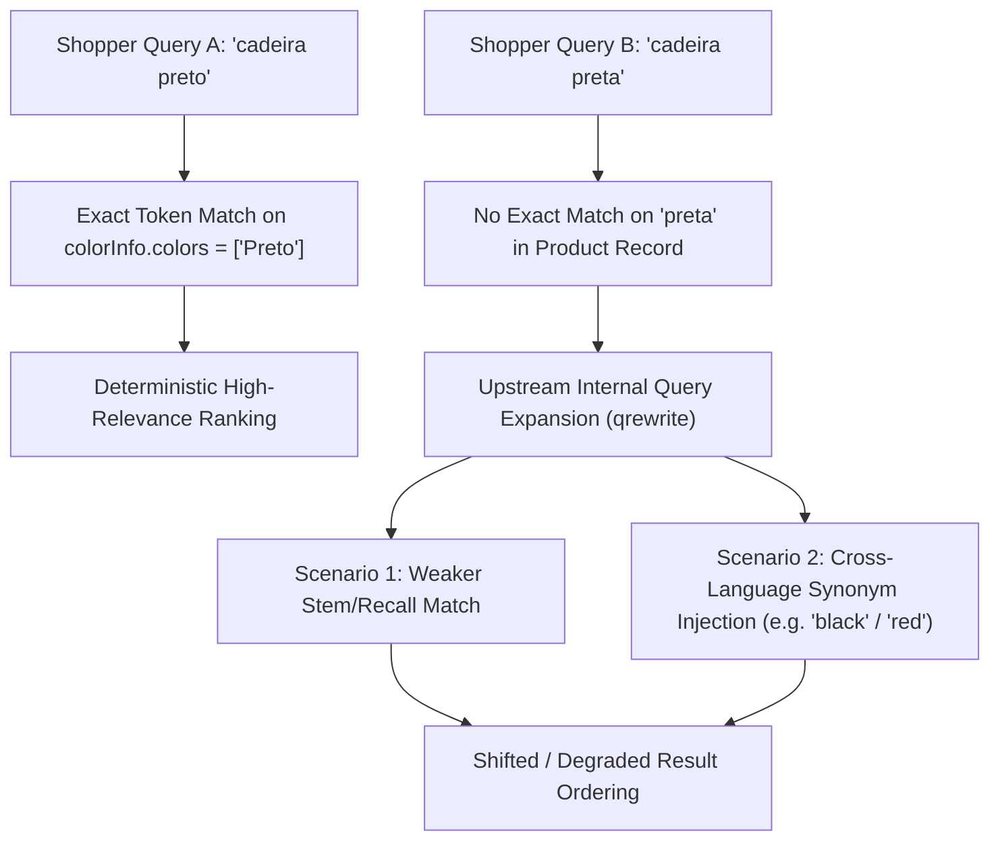
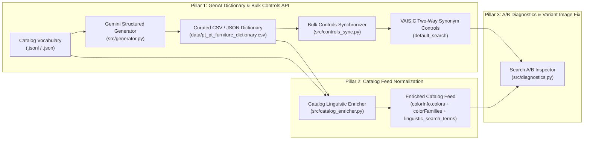

# Vertex AI Search for Commerce — Romance Language Linguistic Toolkit (`pt-PT`, `es-ES`, `fr-FR`, `it-IT`)

An end-to-end reference toolkit for solving **grammatical gender inflections** (`preto` vs. `preta`, `negro` vs. `negra`), **missing accents/diacritics** (`sofá` vs. `sofa`, `cadeirão` vs. `cadeirao`), and **regional/domain synonyms** (`cadeirão` vs. `poltrona`, `candeeiro` vs. `luminária`) in **Google Cloud Vertex AI Search for Commerce (VAIS:C / Retail API)**.

> **🇨🇴 / 🇪🇸 / 🇵🇹 Documentación en Español**: Consulta la [**Guía de Implementación paso a paso en Español (`docs/GUIA_IMPLEMENTACION_ES.md`)**](docs/GUIA_IMPLEMENTACION_ES.md).

---

## 1. The Problem Explained in Plain Terms

In Romance languages (Portuguese, Spanish, French, Italian), **adjectives change their ending to match the grammatical gender and number of the noun** they describe:

* In a product catalog, colors and finishes are typically standardized in a **single dictionary form**—almost always the **masculine singular**:
  * Product Title: *"Cadeira de jantar em madeira de olmo Preto Claro"*
  * Color Attribute: `colorInfo.colors = ["Preto Claro"]`
* Real shoppers, however, type queries that agree grammatically with the furniture item they are looking for, omit diacritics on mobile keyboards, or use regional synonyms:
  * **Feminine noun (`cadeira`, `mesa`, `poltrona`)**: Shoppers search **`"cadeira preta"`** or **`"mesa branca"`** (feminine), whereas the catalog only stores **`"Preto"`** or **`"Branco"`** (masculine).
  * **Missing accents/diacritics**: Shoppers search **`"sofa preto"`**, **`"cadeirao"`**, **`"armario"`**, or **`"candeeiro de pe"`** instead of `"sofá preto"`, `"cadeirão"`, `"armário"`, or `"candeeiro de pé"`.
  * **Regional & category synonyms**: Shoppers search **`"poltrona"`** instead of `"cadeirão"`, or **`"luminária"` / `"abajur"`** instead of `"candeeiro"`.

### Why Do Search Results Diverge Between `"cadeira preto"` and `"cadeira preta"`?



1. **Asymmetric Exact-Match Boosting**: Vertex AI Search for Commerce rewards exact token matches on `title` and `colorInfo.colors`. Searching `"cadeira preto"` hits an exact match on `"Preto"`, whereas `"cadeira preta"` does not.
2. **Upstream Query Expansion (`qrewrite`)**: When a feminine inflection (`"preta"` or `"roja"`) does not match a literal catalog token, the search engine's internal query rewriter (`qrewrite`) expands the query. Sometimes this expansion is weaker than an exact match; in other cases, `qrewrite` injects a cross-language English synonym (such as `"black"` or `"red"`), which inadvertently boosts popular products that happen to have English words in their collection/brand name.

---

## 2. The 3-Pillar Solution Architecture

To guarantee **identical, high-precision search results** regardless of grammatical gender, pluralization, accents, or regional synonyms, this repository implements a **3-Pillar Architecture**:



### Pillar 1: GenAI Linguistic Dictionary + Bulk Serving Controls API (`src/generator.py` & `src/controls_sync.py`)
* **Solves the Merchandising Console CSV Limitation**: The Google Cloud Console UI does not allow uploading synonym rules in bulk from a CSV file.
* **How it works**:
  1. `src/generator.py` extracts unique colors, categories, and materials from your catalog and uses **Gemini** (`GEMINI_MODEL` configured via environment variables) plus deterministic Unicode NFD accent normalization to generate a spreadsheet-friendly CSV (`data/pt_pt_furniture_dictionary.csv`).
  2. SEO and Merchandising teams can review or edit the CSV directly in Google Sheets or Excel.
  3. `src/controls_sync.py` bulk-creates or updates **Two-Way Synonym Controls** (`Rule.TwowaySynonymsAction`) via the Retail v2 REST API and attaches them to your `default_search` ServingConfig in seconds.
* **Quota Efficiency**: VAIS:C allows up to **100 controls per ServingConfig** and up to **100 synonym terms per control**. Instead of creating thousands of 2-word rules, this toolkit groups all masculine/feminine/plural/unaccented inflections of a concept into a single cohesive rule group (e.g., `pt-color-preto`: `preto | preta | pretos | pretas | negro | negra | negros | negras`), using **only ~30 controls** for an entire furniture catalog.

### Pillar 2: Catalog Feed Normalization (`src/catalog_enricher.py`)
* **Why Catalog Enrichment is Essential**: Adding Two-Way Synonym Controls tells VAIS:C that `preto ↔ preta`, which fixes query recall. However, storing **both grammatical genders** directly inside the product's `colorInfo.colors` array ensures that `"cadeira preta"` achieves a **100% native exact match** on the product record—preventing internal query expansion (`qrewrite`) from ever needing to guess or inject cross-language terms.
* **What `enrich-catalog` does automatically**:
  1. **`languageCode`**: Ensures every product carries a valid BCP-47 tag (e.g., `"pt-PT"`).
  2. **`colorInfo.colorFamilies`**: Maps localized colors to Google's 13 canonical standard color families (`"Black"`, `"White"`, `"Gray"`, `"Brown"`, `"Red"`, `"Pink"`, `"Orange"`, `"Yellow"`, `"Green"`, `"Cyan"`, `"Blue"`, `"Purple"`, `"Mixed"`).
  3. **`colorInfo.colors`**: Expands single-gender colors and compound shades (up to 75 values allowed by schema). For example:
     * Input: `{"colors": ["Preto Claro"]}`
     * Enriched Output: `{"colorFamilies": ["Black"], "colors": ["Preto Claro", "Preto", "Preta", "Pretos", "Pretas", "Negro", "Negra", "Negros", "Negras", "Preta Clara"]}`
  4. **`attributes.linguistic_search_terms`**: Adds accent-stripped and synonym tokens onto the product record.

### Pillar 3: Search A/B Diagnostics & Variant Thumbnail Resolution (`src/diagnostics.py`)
* **Side-by-Side Query Diagnostics**: Compares any two queries (e.g., `"cadeira preto"` vs. `"cadeira preta"`) against your live `default_search` placement, computes **Jaccard Similarity** and **Exact Rank Agreement**, and captures both **`attributionToken`** strings.
* **Storefront Variant Thumbnail Fix (`resolve_display_image`)**:
  * When searching for a color-specific query like `"cadeira preta"`, VAIS:C returns the `PRIMARY` product plus matching `VARIANT` items inside `results[].product.variants`.
  * The top-level `results[].product.images[0].uri` on the `PRIMARY` item is rolled up from an arbitrary variant (which is why the Merchandising Console preview may show a beige or oak chair even when searching `"cadeira preta"`).
  * **Storefront Rule**: Always render `results[].product.variants[0].images[0].uri` when present, falling back to `results[].product.images[0].uri`.

---

## 3. Repository Structure

```text
vais-commerce-linguistic-toolkit/
├── .env.example                          # Environment variables template (no hardcoded models)
├── requirements.txt                      # Python dependencies
├── README.md                             # Main documentation (English)
├── docs/
│   ├── GUIA_IMPLEMENTACION_ES.md         # Full implementation guide in Spanish
│   └── ARCHITECTURE_AND_TROUBLESHOOTING.md # Deep-dive on qrewrite & attributionTokens
├── data/
│   ├── pt_pt_furniture_dictionary.csv    # Ready-to-use Portuguese (pt-PT) dictionary (CSV)
│   ├── pt_pt_furniture_dictionary.json   # Ready-to-use Portuguese (pt-PT) dictionary (JSON)
│   ├── es_es_furniture_dictionary.csv    # Ready-to-use Spanish (es-ES) dictionary (CSV)
│   └── es_es_furniture_dictionary.json   # Ready-to-use Spanish (es-ES) dictionary (JSON)
├── examples/
│   └── sample_catalog_pt.jsonl           # Sample Portuguese furniture catalog feed
├── src/
│   ├── config.py                         # Environment variable configuration loader
│   ├── generator.py                      # Gemini structured dictionary generator & CSV/JSON converter
│   ├── controls_sync.py                  # Retail v2 ControlService & ServingConfig bulk sync
│   ├── catalog_enricher.py               # Product feed ColorInfo & linguistic attribute enricher
│   ├── diagnostics.py                    # Search A/B comparison, attributionToken & variant image helper
│   └── cli.py                            # Unified CLI entry point
└── tests/
    └── test_toolkit.py                   # Automated unit test suite
```

---

## 4. Quickstart & Usage

### Step 1: Install & Configure Environment

```bash
git clone https://github.com/papelamineG/vais-commerce-linguistic-toolkit.git
cd vais-commerce-linguistic-toolkit

python3 -m venv .venv
source .venv/bin/activate
pip install -r requirements.txt

cp .env.example .env
# Edit .env with your GOOGLE_CLOUD_PROJECT, GOOGLE_CLOUD_PROJECT_NUMBER, and GEMINI_MODEL
```

Authenticate with Google Cloud:

```bash
gcloud auth application-default login
```

### Step 2: Preview or Customize the Portuguese (`pt-PT`) Synonym Controls (Dry-Run)

The repository includes a ready-to-use Portuguese furniture & home decor dictionary in [`data/pt_pt_furniture_dictionary.csv`](data/pt_pt_furniture_dictionary.csv) covering 30 color-gender, category-synonym, accent, and material groups.

Preview the exact `ControlService.CreateControl` REST payloads before applying any changes:

```bash
python3 -m src.cli sync-controls \
  --dictionary data/pt_pt_furniture_dictionary.csv
```

When ready to push the controls live to Vertex AI Search for Commerce and attach them to `default_search`:

```bash
python3 -m src.cli sync-controls \
  --dictionary data/pt_pt_furniture_dictionary.csv \
  --apply
```

> **Note**: Newly attached Serving Controls take approximately **5 minutes** to propagate to live traffic and the Merchandising Console Evaluate page.

### Step 3: Enrich Your Catalog Feed (`colorInfo` + Linguistic Attributes)

Run `enrich-catalog` on your catalog export (`.jsonl` or `.json`) before importing products into VAIS:C:

```bash
python3 -m src.cli enrich-catalog \
  --input examples/sample_catalog_pt.jsonl \
  --output examples/enriched_catalog_pt.jsonl \
  --dictionary data/pt_pt_furniture_dictionary.csv \
  --language pt-PT
```

**Before (`examples/sample_catalog_pt.jsonl`)**:
```json
{
  "id": "173688",
  "type": "PRIMARY",
  "title": "Cadeira de jantar em madeira de olmo Uish Edition Preto Claro",
  "categories": ["Móveis > Cadeiras > Cadeiras de jantar"],
  "colorInfo": {
    "colors": ["Preto Claro"]
  }
}
```

**After (`examples/enriched_catalog_pt.jsonl`)**:
```json
{
  "id": "173688",
  "type": "PRIMARY",
  "languageCode": "pt-PT",
  "title": "Cadeira de jantar em madeira de olmo Uish Edition Preto Claro",
  "categories": ["Móveis > Cadeiras > Cadeiras de jantar"],
  "colorInfo": {
    "colorFamilies": ["Black"],
    "colors": [
      "Preto Claro",
      "Preto",
      "Preta",
      "Pretos",
      "Pretas",
      "Negro",
      "Negra",
      "Negros",
      "Negras",
      "Preta Clara"
    ]
  },
  "attributes": {
    "linguistic_search_terms": {
      "text": [
        "cadeira de jantar em madeira de olmo uish edition preto claro",
        "amadeirado",
        "amadeirada",
        "carvalho",
        "acacia",
        "preta",
        "pretos",
        "pretas"
      ]
    }
  }
}
```

### Step 4: Generate New Synonym Groups from Your Full Catalog Using Gemini

To automatically discover new colors, materials, or furniture nouns from a larger catalog export using Gemini (`GEMINI_MODEL` in `.env`):

```bash
python3 -m src.cli generate \
  --catalog path/to/your_full_catalog.jsonl \
  --language pt-PT \
  --output-json data/generated_pt_dictionary.json \
  --output-csv data/generated_pt_dictionary.csv
```

### Step 5: Run Side-by-Side Search A/B Diagnostics (`diagnose`)

Verify that masculine vs. feminine or accented vs. unaccented queries return consistent rankings and capture `attributionToken`s:

```bash
python3 -m src.cli diagnose \
  --query-a "cadeira preto" \
  --query-b "cadeira preta"
```

---

## 5. Running the Unit Tests

```bash
python3 -m unittest discover -s tests -v
```
